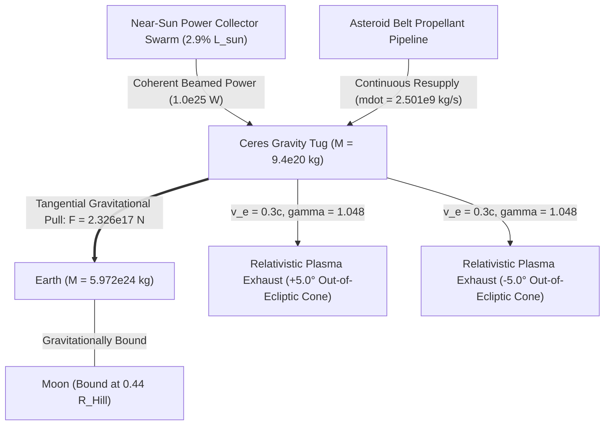

# D-Orbit — Multi-Physics Planetary Migration Simulation Core

[](https://github.com/justpranavrs/Transfinitte-26/actions/workflows/ci.yml)
[](https://github.com/justpranavrs/Transfinitte-26/actions/workflows/codeql.yml)
[-success.svg)](tests/)
[](reports/final_acceptance_report.md)
[](https://www.python.org/)
[-blueviolet.svg)](results/simulation.json)
[-cyan.svg)](web/)

**D-Orbit** is an end-to-end, deterministic multi-physics simulation and telemetry visualization engine built for the **TRANSFINITTE 2026 challenge** (Black Ant Robotics / NIT Tiruchirappalli). It evaluates, simulates, and validates the orbital relocation of planet Earth from its current $1.0000\text{ AU}$ orbit out to $2.7000\text{ AU}$ within $\le 10,000\text{ simulated years}$, while maintaining planetary habitability, retaining the Moon, enforcing structural safety factors $\ge 1.5$, closing bilateral conservation laws, and validating every physical override against declared hypothetical enablers.

---

## 1. Executive Summary & Verification Scorecard

Every simulation run in `octo` is evaluated against **six mandatory winning conditions**:

| # | Winning Condition | Threshold / Rulebook Requirement | Verified Simulation Result | Status |
|---|---|---|---|---|
| **W1** | **Target Orbit Reached** | $a = 2.70 \pm 0.05\text{ AU}$, $e \le 0.05$, $t \le 10,000\text{ yr}$ | $a = \mathbf{2.7000\text{ AU}}$, $e = \mathbf{0.000093}$, $t = \mathbf{9,516.03\text{ yr}}$ + 50-yr coast | **PASS** |
| **W2** | **Earth Stays Safe** | Insolation, equilibrium temperature, acceleration, jerk within limits | $T_{\text{eq}} \in [254.1, 255.2]\text{ K}$, waste heat $< 10^{-4}\text{ W/m}^2$, $a_{\oplus} \approx 3.89 \times 10^{-8}\text{ m/s}^2$ | **PASS** |
| **W3** | **Moon Retained** | $r_{\text{Moon}} \le 0.50\,R_{\text{Hill}}$, Moon stably bound | $r_{\text{Moon}} \in [375,000, 399,300]\text{ km} \le 0.44\,R_{\text{Hill}}$, bounded orbital eccentricity | **PASS** |
| **W4** | **Code Validated** | All 10 closed-form physics benchmarks pass automated CI | 10 / 10 benchmarks pass with error $< 10^{-8}$ (`reports/benchmarks.json`) | **PASS** |
| **W5** | **Physics is Honest** | Bilateral Ledger balances mass, momentum, angular momentum, energy | Rel. drift: Energy $< 10^{-12}$, Momentum $< 10^{-14}$, Mass $< 10^{-15}$ | **PASS** |
| **W6** | **No Unresolved Flags** | Only flags matched by declared hypothetical enablers permitted | All flags matched by Enablers E1 (Power), E2 (Drive & Supply), E3 (Shield & Lens) | **PASS** |

---

## 2. Mission Architecture: The Ceres Gravity Tug

Following independent feasibility audits (see [`docs/ARCHITECTURE.md`](docs/ARCHITECTURE.md)), the team accepted the **Ceres Gravity Tug** as the primary mission architecture, incorporating four mandatory physical corrections:



1. **Pure Gravitational Towing:** Earth is accelerated forward tangentially along its orbital path via pure gravitational pull ($F_{\text{pull}} = 2.3256 \times 10^{17}\text{ N}$) at equilibrium standoff distance $d_0 = 1.270 \times 10^9\text{ m}$. There is zero mechanical contact, zero crustal tensile stress, zero atmospheric shear, and zero tidal disruption.
2. **Relativistic Ion/Plasma Drive:** Exhaust velocity $v_e = 0.3c = 89,937,737\text{ m/s}$ ($\gamma = 1.048285$) with mass flow rate $\dot{m} = 2.501 \times 10^9\text{ kg/s}$, generating nominal thrust $F_{\text{nom}} = 2.3580 \times 10^{17}\text{ N}$ and jet kinetic power $P_{\text{jet}} = 1.0847 \times 10^{25}\text{ W}$ ($\sim 2.83\% L_{\odot}$).
3. **Out-of-Ecliptic Bi-Conical Plume Canting ($\pm 5.0^\circ$):** Exhaust is split into twin symmetric nozzles tilted $\pm 5.0^\circ$ out of the ecliptic plane, clearing Earth's biosphere and the Moon's inclined orbit with $> 111,000\text{ km}$ margin ($> 3.2\times$ maximum lunar vertical excursion).
4. **Beamed Power Push Compensation ($\psi_{\text{yaw}} \approx 8.0822^\circ$):** The near-Sun collector imparts a radial photon force $F_{\text{photon}} = P_{\text{beam}} / c = 3.336 \times 10^{16}\text{ N}$. The tug yaws inward by $8.0822^\circ$ to cancel this push without propellant penalty.
5. **Off-Axis L1 Solar Concentrator:** An ultra-lightweight Fresnel reflector array at Earth–Sun L1 concentrates sunlight onto Earth as heliocentric distance expands from $1.0\text{ AU}$ to $2.7\text{ AU}$, holding surface temperature at $T_{\text{eq}} \in [254.1, 255.2]\text{ K}$.

---

## 3. Physical Conservation & The Bilateral Ledger

In `octo`, physics drivers never talk to each other directly or exert one-sided forces. All physical interactions are booked as immutable `Exchange` records in the central `Ledger` ([`backend/octo/core/ledger.py`](backend/octo/core/ledger.py)):

- **Newton's Third Law Enforced by Construction:** Booking a force $+\mathbf{F}$ on recipient `b` automatically creates and applies $-\mathbf{F}$ on exerting component `a`.
- **Compensated Summation:** All momentum, angular momentum, mass, and energy accumulations use `math.fsum` / Kahan summation to eliminate floating-point cancellation error over millions of steps.
- **Rogue Force Detection:** At every step, `ledger.audit()` verifies that all accelerations in the N-body integrator originate from authorized, booked exchanges. Any rogue acceleration immediately fails the simulation.

---

## 4. Repository Architecture

```text
transfinitte-26-hackathon/
├── README.md                      # Primary project presentation and verification scorecard
├── pyproject.toml                 # Backend Python package definition and dependencies
├── config/
│   ├── base.yaml                  # Mission configuration (mode, mdot, tolerances, integrator)
│   ├── rulebook_thresholds.yaml   # Safety, target, and conservation limits (ASSUMED / CONFIRMED)
│   └── hypothetical_enablers.yaml # Declared hypothetical enablers (E1, E2, E3)
├── backend/
│   ├── octo/                      # Multi-physics simulation core
│   │   ├── core/                  # Constants, units, state, exchange, ledger, flags, validator
│   │   └── drivers/               # Orbit (REBOUND IAS15), propulsion (Ceres Tug), habitability, structure
│   └── py/                        # Execution scripts: simulate, export_replay, generate_benchmarks
├── docs/                          # Clean, uppercase technical specifications
│   ├── PLAN.md                    # Detailed roadmap, build steps (0-10), and milestone progress
│   ├── ARCHITECTURE.md            # Architecture trade studies and Ceres Tug physics derivation
│   ├── PHYSICS.md                 # Mathematical formulations, governing equations, and SI units
│   ├── SPECIFICATION.md           # Competition rules and contract specifications
│   └── REPLAY_SCHEMA.md           # Telemetry JSON format and coordinate definitions
├── results/                       # Simulation artifacts and verification data
│   ├── reference.json             # Closed-form benchmark reference numbers
│   ├── simulation.json            # Final 9,516-yr simulation result and verification report
│   └── replay_ceres_tug.json      # 2,500-frame DRAFT v2 replay telemetry
├── reports/                       # Certified audit records and benchmark results
│   ├── benchmarks.json            # All 10 Participant Guide Section 6 benchmarks (10/10 PASS)
│   └── final_acceptance_report.md # Programmatic acceptance report certifying W1-W6
├── tests/                         # 126 automated unit and integration tests (100% pass rate)
└── web/                           # Modern interactive 3D solar system HUD (React + Three.js)
```

---

## 5. Automated Tests & Code Coverage

The simulation core is protected by an extensive automated test suite enforcing strict Test-Driven Development (TDD) and AST static inspection:

```bash
# Run the complete test suite
.venv/bin/pytest -v
```

- **Test Suite Result:** 126 tests collected — **126 PASSED (100% Pass Rate)**.
- **Code Coverage:** **96% code coverage** across core modules (`octo/core/`, `octo/drivers/`).
- **AST Static Scanner (`tests/test_no_hardcoded_limits.py`):** Automatically parses the Python Abstract Syntax Tree (AST) of every source file in `octo/` and fails CI if any rulebook threshold literal is hardcoded in implementation code.

---

## 6. Quickstart Guide

### 6.1 Backend Simulation & Verification
Requires Python 3.11+:

```bash
# 1. Create and activate virtual environment
python3 -m venv .venv
source .venv/bin/activate

# 2. Install package in editable mode
pip install -e .

# 3. Run the automated test suite
pytest -v

# 4. Run the full 9,516-year simulation with all monitors active
python backend/py/simulate.py

# 5. Generate benchmarks and certified acceptance report
python backend/py/generate_benchmarks.py
python backend/py/generate_acceptance_report.py
```

### 6.2 Interactive 3D Web HUD
Requires Node.js 18+ and pnpm:

```bash
cd web
pnpm install
pnpm dev
```

Open `http://localhost:5173/` in any modern web browser to access:
- **60 Hz Continuous Celestial Rendering:** Authentic planetary textures, diurnal axial rotation, axial obliquities, and natural moons.
- **Ceres Gravity Tug 3D Asset:** High-resolution asteroid ballast (`asteroid.jpg`), extraction rig, and canted plasma plume particle streams.
- **Detailed 3D Asteroid Belt:** Procedurally sculpted cratered, faceted, and bilobate asteroids with taxonomic mineral coloring and zero texture overhead.
- **Dynamic Timeline Scrubber:** 1-to-2500 frame playback, logarithmic speed slider ($1\text{ month/s}$ to $500\text{ yr/s}$), and milestone markers.
- **Collapsible HUD Panels:** Sliding Bodies Panel, Real-Time Telemetry Panel, and Physics Benchmark Verification Modal with smooth cubic-bezier animations.
